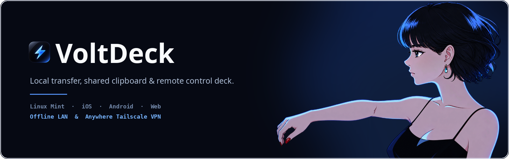
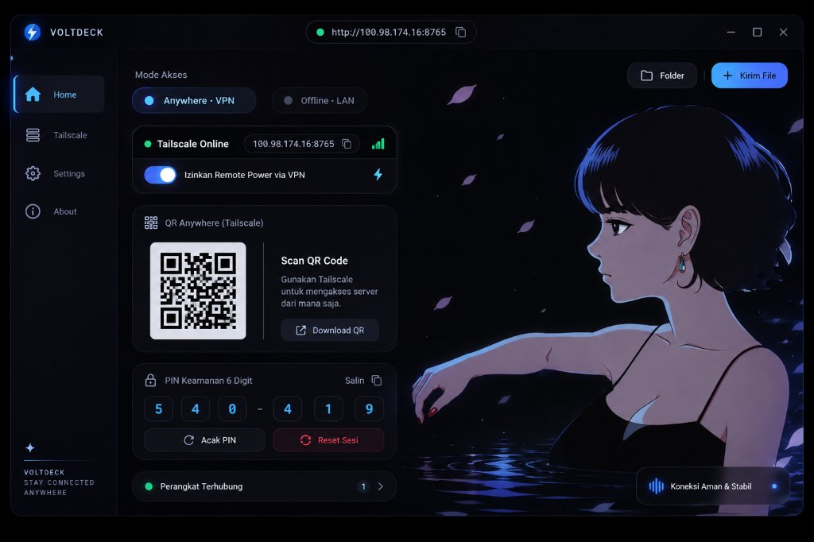

<div align="center">



# VoltDeck — Transfer File & Remote Control Linux dari HP/Browser

[](https://www.python.org/)
[](https://webkitgtk.org/)
[](https://linuxmint.com/)
[](#)
[](#)
[](LICENSE)

[English](README.md) · **Bahasa Indonesia**

**Alternatif AirDrop & KDE Connect ringan untuk Linux Mint, Ubuntu, dan Debian tanpa perlu install aplikasi di HP.** Transfer file 2 arah streaming, jelajah file laptop, shared clipboard, galeri & webcam laptop, live screen view MJPEG, monitor RAM, dan remote control penuh langsung dari **Safari, Chrome, Firefox, atau Edge** — mendukung **Mode Offline (Wi-Fi LAN)** dan **Mode Anywhere (Tailscale Private VPN)**.

</div>

---

## 🖥️ Pratinjau Tampilan

<div align="center">
  
</div>

---

## ✨ Fitur Utama

### 🔄 Transfer File 2 Arah Streaming
- **HP / Browser → Linux Mint:** Upload biner *chunked streaming* (`256 KB`/chunk) langsung ke `~/Downloads/LANShare` tanpa memuat seluruh file ke RAM, lengkap dengan progress bar, kecepatan (MB/s), dan tombol batal.
- **Linux Mint → HP / Browser:** *Zero-copy* file sharing dengan dukungan HTTP `Range` (`206 Partial Content`), pratinjau lightbox foto/video, thumbnail otomatis, dan unduh massal streaming `.zip`.
- **Integrasi Native Linux Mint:**
  - *Drag-and-drop* langsung dari **Nemo** ke jendela VoltDeck.
  - Menu klik kanan Nemo: **`Kirim ke iPhone (VoltDeck)`**.
  - **Paste Screenshot (`Ctrl+V`)** langsung dari clipboard Linux Mint ke perangkat yang terhubung.
  - Tombol **Kamera** langsung di browser HP (iOS & Android) untuk memotret dokumen/catatan langsung ke laptop.

### 📋 Shared Clipboard 2 Arah + Buka Link di Laptop
- Sinkronisasi otomatis clipboard Linux Mint (`Gtk.Clipboard`) ke iOS, Android, dan browser desktop (termasuk tombol *Salin* yang kompatibel dengan HTTP lokal).
- Tempel pesan berisi tautan dari WhatsApp di HP → ketuk **`Buka di Laptop`** untuk langsung membuka tautan tersebut di browser default Linux Mint.

### 🖼️ Galeri, File Explorer & Ambil Gambar dari Laptop
- **File Explorer Aman (Sandboxed):** Jelajahi folder aman laptop (`Documents`, `Downloads`, `Desktop`, `Pictures`, `Music`, `Videos`, `LANShare`), cari file, dan unduh langsung PDF, DOCX, ZIP, dll. ke HP (file tersembunyi/dotfile & path traversal diblokir ketat).
- **Galeri Foto:** Jelajah foto dari folder laptop dalam grid thumbnail responsif dengan lightbox ramah notch iPhone.
- **Ambil Gambar Instan:** **Foto Webcam Laptop** (`/dev/video0` via GStreamer / `fswebcam` / `ffmpeg`) & **Screenshot Layar** 1 ketuk langsung unduh ke HP.

### 🎛️ Remote Control Lengkap
- **Telemetry Real-Time & Live Sync 1.5 Detik:** Pantau **Baterai (+ status charger)**, **CPU %**, **RAM %**, dan **Suhu (°C)** sambil menyinkronkan **Media, Volume, dan Kecerahan** secara otomatis tiap 1.5 detik selama tab Remote terbuka (0% beban saat idle/tertutup).
- **Media Cerdas (Sticky Player) & Audio:** Play/Pause, Next/Prev, Seek `±10 dtk` via D-Bus **MPRIS2** (Spotify, Chrome/YouTube, VLC, Celluloid) dengan **pelacakan player aktif** (pause Spotify tetap terkunci di Spotify, tidak loncat ke Chrome) + **chip pilih player 1-ketuk**, slider volume, serta **Ganti Output Audio** (Speaker ↔ Headset/Bluetooth via `pactl`).
- **Layar, Privacy Mode 1-Ketuk & Daya Aman:** Slider kecerahan layar, **Matikan Layar Saja** (`DPMS`), **Mode Privasi 1-Ketuk** (*Pause media + Mute audio + Kunci layar + Matikan layar*), **Kunci Layar**, **Sleep**, **Restart**, dan **Matikan Laptop** dengan konfirmasi 2× ketuk + timer (`15 dtk / 15 mnt / 30 mnt / 60 mnt`) + tombol **Batalkan** di HP maupun Desktop.
- **App Launcher & Pintasan Web Cepat:** Buka aplikasi terpasang di Linux (Chrome, Firefox, Nemo, Terminal, VS Code, Spotify, LibreOffice, Settings, dll.) melalui *allowlist* aman, atau buka **YouTube, GitHub, WhatsApp Web, ChatGPT, dan Gmail** di browser laptop dalam 1 ketuk.
- **Monitor Tugas RAM On-Demand:** Lihat proses dengan pemakaian RAM tertinggi secara *on-demand* (0% beban saat idle) dan tutup aplikasi yang hang dengan konfirmasi 2× ketuk (proses inti sistem dilindungi).
- **Layar Live (MJPEG):** Pantau layar laptop secara langsung di Safari, Chrome, atau Firefox (`2 / 5 / 8 FPS`) + opsi **Tap-untuk-Klik**.
- **Touchpad & Clicker Presentasi:** Trackpad sentuh/mouse via X11 `XTest`, tombol slide (`Prev / Next / F5 / Esc`), dan keyboard jarak jauh.

### 🌐 Dual-Mode & Keamanan
- **`Offline · LAN` (Default):** Hanya mengizinkan koneksi Wi-Fi/LAN lokal (`192.168.x.x` / `10.x.x.x` / `.local`) dan memblokir akses eksternal (`403 Forbidden`).
- **`Anywhere · VPN` (Tailscale):** Akses & kontrol laptop dari mana saja (4G/5G) lewat jaringan privat terenkripsi *end-to-end* Tailscale (tersedia di Linux, iOS, Android, Windows & macOS) — IP internet publik mentah tetap selalu diblokir.
- **Custom PIN Permanen 6 Digit (Setup Awal):** Buat PIN 6 digit pilihan sendiri saat pertama kali membuka VoltDeck (atau gunakan PIN acak), tersimpan permanen di `~/.config/lanshare/config.json` (izin `0600`) dengan masking privasi + tombol tampil/sembunyikan, peringatan PIN lemah, verifikasi *constant-time*, proteksi *brute-force* (lockout 60 detik setelah 5× salah), ubah/acak PIN, dan pemutusan sesi instan.
- **Trusted Device:** Tandai perangkat iOS/Android Anda sebagai **Perangkat Terpercaya** (disimpan sebagai hash SHA-256 di `~/.config/lanshare/trusted_devices.json`, izin `0600`) agar tetap otomatis masuk meski laptop di-restart.
- **GTK3 Single-Instance & Standby Autostart Hemat RAM:** Mode `--tray` siaga di *system tray* Linux Mint tanpa memuat WebKit2 sampai jendela dibuka (~25–35 MB RAM).
- **Tampilan Style iOS / macOS + Mode Terang & Gelap:** Antarmuka *frosted glass* elegan bergaya Apple lengkap dengan toggle **Mode Terang & Gelap** yang sinkron di Desktop & Web, switch & segmented control khas iOS/macOS, keypad PIN bulat ala Lock Screen iPhone, ikon SVG monoline bersih (tanpa emoji), serta responsif di HP, Tablet/iPad, dan Desktop Browser.

---

## 🛠️ Persyaratan Sistem (Linux Mint / Ubuntu / Debian)

```bash
sudo apt update
sudo apt install -y \
  python3 python3-gi gir1.2-gtk-3.0 gir1.2-webkit2-4.1 \
  gir1.2-ayatanaappindicator3-0.1 gir1.2-notify-0.7 \
  python3-pil python3-qrcode python3-netifaces python3-psutil \
  python3-xlib python3-dbus pulseaudio-utils x11-xserver-utils
```

*(Opsional untuk **Mode Anywhere** jarak jauh: install [Tailscale](https://tailscale.com/download/linux) lalu jalankan `sudo tailscale up`.)*

---

## 🚀 Instalasi & Cara Menjalankan

```bash
# 1. Clone repository
git clone https://github.com/Gunturaa/VoltDeck.git
cd VoltDeck

# 2. Pasang ikon PETIR, shortcut Menu & Desktop, Klik Kanan Nemo, & Autostart Standby
bash install_shortcut.sh

# 3. Jalankan aplikasi desktop VoltDeck
python3 lanshare.py
```

### Opsi CLI (Single-Instance)

```bash
# Jalankan siaga di system tray (hemat RAM)
python3 lanshare.py --tray

# Jalankan di port khusus
python3 lanshare.py --port 9000

# Kirim file langsung ke antrean VoltDeck yang sedang berjalan
python3 lanshare.py ~/Documents/laporan.pdf ~/Downloads/foto.jpg

# Mode headless (server saja tanpa jendela GTK3)
python3 lanshare.py --headless
```

---

## 🔥 Konfigurasi Firewall (UFW)

```bash
# Untuk Mode Offline (LAN / Wi-Fi lokal)
sudo ufw allow 8765/tcp comment 'VoltDeck LAN'

# Opsional: khusus Mode Anywhere (Tailscale VPN)
sudo ufw allow in on tailscale0 to any port 8765 proto tcp comment 'VoltDeck Tailscale'
```

---

## 🧪 Pengujian Otomatis

```bash
python3 -m unittest discover -s tests -v
```

Mencakup **15 pengujian end-to-end otomatis**: Custom PIN permanen & proteksi brute-force, Mode Terang/Gelap, streaming upload/download (`Range 206`, thumbnail, `.zip`), shared clipboard 2 arah + SSE, sticky MPRIS2 player & live sync remote, layar live MJPEG, Dual-Mode *Offline vs Anywhere*, Trusted Device lintas restart, App Launcher, Webcam, Galeri, Bilingual ID/EN, File Explorer aman, Task Monitor RAM, dan Mode Privasi 1-ketuk.

---

<div align="center">
  <sub>© 2026 <strong>VoltDeck</strong> · Stay Connected Anywhere</sub>
</div>
