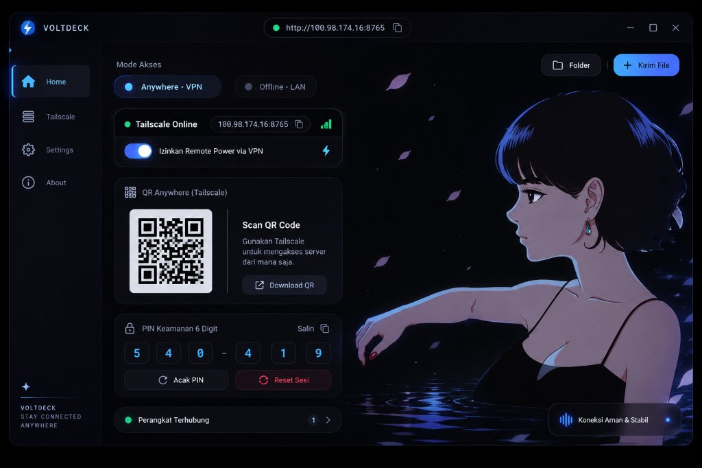

<div align="center">


# VoltDeck — AirDrop, File Transfer & Remote Control for Linux

[](https://www.python.org/)
[](https://webkitgtk.org/)
[](https://linuxmint.com/)
[](#)
[](#)
[](LICENSE)

**English** · [Bahasa Indonesia](README.id.md)

**A lightweight, zero-mobile-app companion for Linux Mint, Ubuntu, and Debian.** Transfer files two-way between iPhone/Android and Linux, browse laptop files, sync clipboard, view live screen (MJPEG), and control volume, media, brightness, apps, RAM tasks, and power straight from **Safari, Chrome, Firefox, or Edge** — over **Local Wi-Fi (Offline LAN)** or **Tailscale Private VPN (Anywhere Mode)**.

</div>

---

## 🖥️ Interface Preview

<div align="center">
  
</div>

---

## 💡 Why VoltDeck? (Alternative to AirDrop, KDE Connect & LocalSend for Linux)

| Feature | **VoltDeck** | KDE Connect | LocalSend |
| --- | :---: | :---: | :---: |
| **Zero Mobile App Required (Safari / Chrome)** | ✅ | ❌ | ❌ |
| **Two-Way Streaming File Transfer (iPhone/Android ↔ Linux)** | ✅ | ✅ | ✅ |
| **Sandboxed Laptop File Explorer & Photo Gallery** | ✅ | Partial | ❌ |
| **Live Screen View (MJPEG) + Tap-to-Click** | ✅ | ❌ | ❌ |
| **Media, Volume, Audio Output Switcher & Brightness** | ✅ | ✅ | ❌ |
| **On-Demand RAM Task Monitor & 1-Tap Privacy Mode** | ✅ | ❌ | ❌ |
| **Remote Access Over 4G/5G via Tailscale VPN** | ✅ | Manual | ❌ |
| **Low-RAM System Tray Standby (~25–35 MB)** | ✅ | ✅ | ✅ |

---

## ✨ Features

### 🔄 Two-Way Streaming File Transfer
- **Phone / Browser → Linux Mint:** Chunked binary streaming (`256 KB` chunks) directly to `~/Downloads/LANShare` with constant low RAM usage, live progress bar, transfer speed (MB/s), and cancel support.
- **Linux Mint → Phone / Browser:** Zero-copy file sharing with HTTP `Range` (`206 Partial Content`) support, image/video lightbox preview, automatic thumbnails, and on-the-fly streaming `.zip` batch downloads.
- **Native Linux Mint Integration:**
  - Drag-and-drop directly from **Nemo** onto the VoltDeck window.
  - Nemo right-click context action: **`Kirim ke iPhone (VoltDeck)`**.
  - **Paste Screenshot (`Ctrl+V`)** directly from the Linux Mint clipboard straight to connected devices.
  - Dedicated **Camera** button on mobile browsers (iOS & Android) to snap documents/notes straight to your laptop.

### 📋 Two-Way Shared Clipboard (Text + Images) + Open Link on Laptop
- Automatic Linux Mint `Gtk.Clipboard` text & image sync to iOS, Android, and desktop browsers (with HTTP-compatible one-tap copy fallback).
- **2-Way Image Clipboard:** Copy a screenshot on Linux → preview & save PNG on your phone; or pick any photo on your phone → send straight to Linux `Gtk.Clipboard` ready to `Ctrl+V` into Figma, Docs, or WhatsApp Web!
- Paste any WhatsApp message or link on your phone → tap **`Buka di Laptop`** to open safe `http(s)://` URLs directly in your default Linux Mint browser.

### 🖼️ Two-Way Laptop File Explorer, Gallery & Instant Capture
- **2-Way Sandboxed File Explorer:** Browse safe laptop directories (`Documents`, `Downloads`, `Desktop`, `Pictures`, `Music`, `Videos`, `LANShare`), search within folders, **upload files straight into any subfolder**, **create new folders**, and stream-download PDFs, DOCX, ZIPs, and more (hidden dotfiles and path traversal are strictly blocked).
- **Photo Gallery:** Browse and pull images directly from laptop folders in a responsive thumbnail grid with safe-area lightbox preview.
- **Instant Capture:** One-tap **Laptop Webcam Capture** (`/dev/video0` via GStreamer / `fswebcam` / `ffmpeg`) and **Desktop Screenshot** straight to your phone.

### 🎛️ Complete Remote Control Deck
- **Real-Time Telemetry, SSD & Battery Full Guard:** Monitor laptop **Battery (+ charging status)**, **CPU %**, **RAM %**, **SSD Free Space**, and **Temperature (°C)** with **1.5s live sync** and a **Battery Full Guard (`90%` / `95%`)** unplug reminder.
- **Smart Sticky Media, Audio & Per-App Volume Mixer:** Play/Pause, Next/Previous, and `±10s` Seek via Session D-Bus **MPRIS2** (Spotify, Chrome/YouTube, VLC, Celluloid) with **sticky active-player tracking** + **multi-player switcher chips**, master volume + **Per-App Volume Mixer** (`pactl sink-inputs` for Spotify/Chrome/Discord individually), and **Audio Output Sink Switcher** (Speakers ↔ Headset/Bluetooth).
- **Bluetooth Quick Connect (Control Center):** Toggle laptop Bluetooth power and 1-tap connect/disconnect paired devices (AirPods/TWS, headsets, speakers via `bluetoothctl`).
- **Window Switcher, Smart Deck & Keep Awake (Caffeine):** List open desktop windows (`wmctrl`) to focus or close in 1 tap, trigger quick shortcuts (`Alt+Tab`, `Show Desktop`, `Fullscreen F11`), and toggle **Keep Awake** (`systemd-inhibit` + `xset`) to keep your laptop awake during downloads or presentations.
- **Display, 1-Tap Privacy Mode & Safe Power Controls:** Brightness slider, **Display Off** (`DPMS`), **1-Tap Privacy Mode** (*Pause media + Mute audio + Lock screen + Display Off*), **Lock Screen**, **Sleep**, **Restart**, and **Shutdown** protected by 2-step confirmation, selectable timer (`15s / 15m / 30m / 60m`), and a live cancel button on both phone and desktop.
- **App Launcher & Quick Web Shortcuts:** Launch installed Linux desktop apps (Chrome, Firefox, Nemo, Terminal, VS Code, Spotify, LibreOffice, Settings, etc.) via a strict binary allowlist, or open **YouTube, GitHub, WhatsApp Web, ChatGPT, and Gmail** on your laptop in one tap.
- **On-Demand RAM Task Monitor:** Inspect top memory-consuming user processes on demand and safely terminate frozen apps with 2-tap confirmation (core system/desktop daemons are strictly protected).
- **Live Screen View (MJPEG) & 1-Tap Screen Recorder:** Stream your Linux Mint screen live in Safari, Chrome, or Firefox (`2 / 5 / 8 FPS`) with optional **Tap-to-Click**, or record your laptop screen in 1 tap (`ffmpeg` MP4 / native GStreamer WebM) straight into your download queue!
- **Touchpad & Presentation Clicker:** Touch/mouse trackpad via X11 `XTest`, presentation keys (`Prev / Next / F5 / Esc`), and remote keyboard typing.

### 🌐 Dual-Mode Access & Security
- **`Offline · LAN` (Default):** Strictly allows local Wi-Fi/LAN clients (`192.168.x.x`, `10.x.x.x`, `172.16–31.x.x`, `.local`) and rejects external/VPN traffic (`403 Forbidden`).
- **`Anywhere · VPN` (Tailscale):** Control and transfer from anywhere (4G/5G) over your private end-to-end encrypted Tailscale mesh (available for Linux, iOS, Android, Windows & macOS) — raw public internet IPs remain strictly blocked.
- **Custom Persistent 6-Digit PIN:** Create your own personal 6-digit pairing PIN on first launch (or generate a random PIN), saved securely in `~/.config/lanshare/config.json` (`0600`) with privacy masking + show/hide toggle, weak-PIN warning, constant-time verification, brute-force lockout (60s after 5 failed attempts), instant PIN editing/rotation, and session revocation.
- **Trusted Devices:** Approve your iOS/Android device as a **Trusted Device** (stored as SHA-256 hash only in `~/.config/lanshare/trusted_devices.json`, `0600`) for seamless auto-login across laptop restarts.
- **GTK3 Single-Instance & Low-RAM Tray Standby:** `--tray` standby mode stays ready in the Linux Mint system tray without initializing WebKit2 until the window is opened (~25–35 MB RAM).
- **Apple iOS / macOS Design with Light & Dark Mode:** Clean frosted-glass UI with Apple-style switches, segmented controls, circular iOS Lock Screen PIN keypad, monoline SVG icons (zero emojis), and synchronized **Light & Dark Mode** across Desktop, phones (bottom nav bar), tablets, and desktop browsers (left sidebar).

---

## 🛠️ System Requirements (Linux Mint / Ubuntu / Debian)

VoltDeck runs on standard Python 3 and native Linux Mint system packages (no extra `pip` packages required when these system libraries are installed):

```bash
sudo apt update
sudo apt install -y \
  python3 python3-gi gir1.2-gtk-3.0 gir1.2-webkit2-4.1 \
  gir1.2-ayatanaappindicator3-0.1 gir1.2-notify-0.7 \
  python3-pil python3-qrcode python3-netifaces python3-psutil \
  python3-xlib python3-dbus pulseaudio-utils x11-xserver-utils
```

*(Optional for **Anywhere Mode**: install [Tailscale](https://tailscale.com/download/linux) and sign in once with `sudo tailscale up`.)*

---

## 🚀 Installation & Quick Start

```bash
# 1. Clone the repository
git clone https://github.com/Gunturaa/VoltDeck.git
cd VoltDeck

# 2. Install icons, App Menu & Desktop shortcuts, Nemo right-click action, & Tray Autostart
bash install_shortcut.sh

# 3. Launch VoltDeck desktop app
python3 lanshare.py
```

### CLI Options (Single-Instance)

```bash
# Start silently in the system tray (low-RAM standby)
python3 lanshare.py --tray

# Run on a custom port
python3 lanshare.py --port 9000

# Queue local files directly into the running VoltDeck instance
python3 lanshare.py ~/Documents/report.pdf ~/Downloads/photo.jpg

# Headless server mode (no GTK3 window)
python3 lanshare.py --headless
```

---

## 🔥 Firewall Setup (UFW)

If UFW is enabled on Linux Mint, allow default port `8765`:

```bash
# For Offline Mode (local Wi-Fi / LAN)
sudo ufw allow 8765/tcp comment 'VoltDeck LAN'

# Optional: for Anywhere Mode (Tailscale private VPN interface)
sudo ufw allow in on tailscale0 to any port 8765 proto tcp comment 'VoltDeck Tailscale'
```

---

## 📁 Project Structure

```text
.
├── lanshare.py                   # Main entrypoint (GTK3 Desktop / --tray / --headless)
├── install_shortcut.sh           # Installs icons, Menu/Desktop shortcuts, Nemo Action & Autostart
├── lanshare.desktop.in           # Linux Mint .desktop launcher template
├── lanshare.nemo_action.in       # Nemo file manager right-click action template
├── assets/
│   ├── generate_icons.py         # Lightning SVG & multi-res PNG icon generator (24px – 512px)
│   ├── lanshare.svg              # Primary VoltDeck vector icon
│   ├── hero_character.png        # Full transparent desktop hero artwork
│   └── hero_character_mobile.png # Compact portrait artwork for mobile screens
├── lanshare/
│   ├── __init__.py               # Application metadata (VoltDeck)
│   ├── config.py                 # Config persistence & XDG Autostart helpers
│   ├── network.py                # LAN interface discovery, mDNS (.local), Tailscale & QR SVG
│   ├── security.py               # 6-digit PIN, rate limiting, HMAC sessions & Trusted Devices
│   ├── storage.py                # Streaming file registry, thumbnails, ZIP stream & gallery scanner
│   ├── clipboard_store.py        # Shared clipboard history & anti-loop hash deduplication
│   ├── remote_control.py         # Telemetry, MPRIS2, pactl, brightness, MJPEG, XTest & power
│   ├── server.py                 # Multi-threaded streaming HTTP + SSE + Dual-Mode network gate
│   ├── desktop_app.py            # GTK3 + WebKit2 Single-Instance app & Ayatana System Tray
│   └── web/                      # Desktop & All-Device Responsive Web UI (HTML/CSS/JS)
└── tests/
    └── test_core.py              # End-to-end automated test suite (16 test cases)
```

---

## 🧪 Running Tests

```bash
python3 -m unittest discover -s tests -v
```

Covers custom persistent 6-digit PIN & brute-force lockout, Light/Dark theme persistence, streaming upload & filename sanitization, streaming download (`Range 206`, thumbnails, streaming ZIP), two-way shared clipboard & SSE events, safe URL opening, sticky MPRIS2 player selection & realtime remote live sync, MJPEG screen view, Dual-Mode *Offline vs Anywhere* enforcement, Trusted Device persistence across restarts, App Launcher allowlist, Webcam snapshot, Laptop Gallery, Bilingual ID/EN i18n, Sandboxed File Explorer, On-Demand RAM Task Monitor, and 1-Tap Privacy Mode.

---

<div align="center">
  <sub>© 2026 <strong>VoltDeck</strong> · Stay Connected Anywhere</sub>
</div>
